# The Feature and Change Map

**One tree: every feature, the slices that build it, the changes that shape it, and what is blocked.**

A snapshot, generated from `02-contracts/features/*.json`, `06-changes/manifest.json` and `06-changes/adoption.json`. Those files stay the truth. Regenerate with section 7.

## 1. How to read it

### The feature tree

| Mark | Means |
|---|---|
| `[partial]` | The feature entry's own status |
| `wired`, `built`, `specified`, `missing` | A slice state, from the feature entry |
| `depends` | The slice ids this slice waits on. `none` means it can start now |
| `reason` | The slice's `blockedBy` text, verbatim |
| `handoff` | Where one app hands the journey to the next, and through what |
| `changes` | Changes that touch this feature and no other. These can ship alone. The line is absent when there are none |
| `shared` | Changes that touch this feature and one or two others |
| `wide` | Contract-wide changes, not repeated here. See section 4 |

### The scope values in section 4

| Scope | Means |
|---|---|
| `feature-specific` | One feature touches those collections, so it can ship alone |
| `shared` | Two or three features touch them, so those apps stay coupled |
| `contract-wide` | Four or more features touch them, so it lands everywhere at once |
| `unmapped` | The change names collections, but no feature entry references them yet |
| `cross-cutting` | The change names no collection, so this link cannot place it |

**A link here is derived, not declared.** It means a shared collection, not a promise that the change is what blocks the slice.

## 2. The feature tree

```text
safaaisaathi, contract 2.3.0
│
├── FEATURE admin-dispatch [designed]
│   The office runs the operation
│   actor   adminpanel, platform
│   │
│   ├── adminpanel  missing   src/App.tsx
│   │     depends  none
│   │     reason   The admin panel has zero Firebase; its data layer is a pure
│   │              localStorage mock and it calls no callable.
│   │
│   ├── platform    specified 04-functions/src/callables/admin.ts
│   │     depends  none
│   │     reason   No app calls these callables; the admin panel has no Firebase, so
│   │              mintStaffToken is never invoked and every admin write targets
│   │              localStorage.
│   │
│   ├── shared   CHG-0002, CHG-0005, CHG-0010, CHG-0011, CHG-0012, CHG-0013, CHG-0017, CHG-0019, CHG-0020, EXT-0001
│   ├── wide     6 contract-wide change(s), see section 4
│   ├── handoff  platform -> adminpanel via mintStaffToken (live)
│   ├── handoff  platform -> adminpanel via setComplaintStatus (live)
│
├── FEATURE arrival-notification [partial]
│   Arrival push notification
│   actor   driverapp, platform, userapp
│   │
│   ├── driverapp   wired     lib/features/tracking/domain/tracking_engine.dart
│   │     depends  none
│   │
│   ├── platform    built     04-functions/src/triggers/arrivalAlert.ts
│   │     depends  none
│   │     reason   callables.json marks arrivalAlert lifecycle as planned; no client is
│   │              wired to the ward_{wardId} topic yet, so the push is not delivered
│   │              end to end.
│   │
│   ├── userapp     built     apps/citizen_app/src/App.tsx
│   │     depends  none
│   │     reason   The user app uses simulation, not a real FCM subscription to
│   │              ward_{wardId}. topics.json x-gaps: 'There is no inbound FCM handler'
│   │              (no onMessage / onBackgroundMessage).
│   │
│   ├── shared   CHG-0005, CHG-0007, CHG-0017, EXT-0001
│   ├── wide     6 contract-wide change(s), see section 4
│   ├── handoff  driverapp -> platform via vans/{vanId} (live)
│   ├── handoff  platform -> userapp via ward_{wardId} (live)
│
├── FEATURE citizen-complaint [partial]
│   Report a problem and track it to resolution
│   actor   userapp, adminpanel, driverapp, platform
│   │
│   ├── userapp     wired     apps/citizen_app/src/services/firebaseService.ts
│   │     depends  none
│   │     reason   The confirm/reject loop writes to localStorage via storageService,
│   │              not to the citizenVerifyResolution / reopenComplaint callables, so
│   │              the cross-verification loop is not wired end to end.
│   │
│   ├── adminpanel  built     src/screens/A17_Complaints.tsx
│   │     depends  none
│   │     reason   The admin panel has zero Firebase; its data layer is a pure
│   │              localStorage mock, and it calls no callable.
│   │
│   ├── driverapp   wired     lib/core/repositories/firestore/firestore_complaints_repository.dart
│   │     depends  none
│   │
│   ├── shared   CHG-0010, CHG-0012, CHG-0013, CHG-0019
│   ├── wide     4 contract-wide change(s), see section 4
│   ├── handoff  userapp -> adminpanel via complaints/{complaintId} (live)
│   ├── handoff  adminpanel -> userapp via setComplaintStatus (live)
│   ├── handoff  userapp -> adminpanel via citizenVerifyResolution (live)
│
├── FEATURE live-van-tracking [partial]
│   Live van tracking and ETA
│   actor   driverapp, userapp, adminpanel
│   │
│   ├── driverapp   wired     lib/features/tracking/domain/tracking_engine.dart
│   │     depends  none
│   │
│   ├── userapp     built     apps/citizen_app/src/App.tsx
│   │     depends  none
│   │     reason   The user app reads seed/simulation data, not real Firestore vans.
│   │              There is no onSnapshot of vans scoped by routeId; grep for
│   │              collection('vans') returns only seedData and simulationService.
│   │
│   ├── adminpanel  built     src/screens/A15_LiveMap.tsx
│   │     depends  none
│   │     reason   The admin panel has zero Firebase; its data layer is a pure
│   │              localStorage mock, so the live map is not wired to the real backend.
│   │
│   ├── shared   CHG-0007
│   ├── wide     6 contract-wide change(s), see section 4
│   ├── handoff  driverapp -> userapp via vans/{vanId} (live)
│   ├── handoff  driverapp -> adminpanel via vans/{vanId} (live)
│
└── FEATURE shift-operations [partial]
    Start a shift, collect the wards, end the shift
    actor   driverapp, platform
    │
    ├── driverapp   wired     lib/features/shift_start/domain/start_shift.dart
    │     depends  none
    │
    ├── platform    specified 04-functions/src/callables/shift.ts
    │     depends  none
    │     reason   No app calls these callables; the driver app writes trips and vans
    │              directly to Firestore instead. bindDeviceToVan, startShift, endShift
    │              and markWardDone are unused.
    │
    ├── shared   CHG-0002, CHG-0005, CHG-0007, CHG-0011, CHG-0017, CHG-0020, EXT-0001
    ├── wide     6 contract-wide change(s), see section 4
    ├── handoff  driverapp -> platform via trips/{tripId} (live)
```

## 3. The change tree

```text
├── CHG-0001 [S2 P2] Freeze the collection and field contract
    apps      driverapp, userapp, adminpanel
    adoption  driverapp adopted, userapp not_started, adminpanel not_started
    features  admin-dispatch, arrival-notification, citizen-complaint, live-van-tracking, shift-operations
    scope     contract-wide

├── CHG-0002 [S1 P1] Move the raw driver phone to staffPhones and mask it at the source
    apps      driverapp, adminpanel
    adoption  driverapp not_started, userapp not_applicable, adminpanel not_started
    features  admin-dispatch, shift-operations
    scope     shared

├── CHG-0003 [S1 P0] Scope the Firestore rules by custom claims instead of by signed-in
    apps      driverapp, userapp, adminpanel
    adoption  driverapp not_started, userapp not_started, adminpanel not_started
    features  admin-dispatch, arrival-notification, citizen-complaint, live-van-tracking, shift-operations
    scope     contract-wide

├── CHG-0004 [S1 P1] Route every admin panel write through a callable
    apps      adminpanel
    adoption  driverapp not_applicable, userapp not_applicable, adminpanel not_started
    features  admin-dispatch, arrival-notification, citizen-complaint, live-van-tracking, shift-operations
    scope     contract-wide

├── CHG-0005 [S1 P1] Shard the GPS trail into a trail subcollection
    apps      driverapp
    adoption  driverapp not_started, userapp not_applicable, adminpanel not_applicable
    features  admin-dispatch, arrival-notification, shift-operations
    scope     shared

├── CHG-0006 [S1 P1] Delete verifyDriverPin, setDriverPin and the vanSecrets collection
    apps      driverapp
    adoption  driverapp not_started, userapp not_applicable, adminpanel not_applicable
    features  none
    scope     cross-cutting

├── CHG-0007 [S2 P2] Set the arrival alert radius to 100 m from the ward boundary
    apps      userapp
    adoption  driverapp not_applicable, userapp not_started, adminpanel not_applicable
    features  arrival-notification, live-van-tracking, shift-operations
    scope     shared

├── CHG-0008 [S1 P0] Put all three apps on one Firebase project
    apps      driverapp, userapp, adminpanel
    adoption  driverapp not_started, userapp not_started, adminpanel not_started
    features  none
    scope     cross-cutting

├── CHG-0009 [S1 P1] Move the backend source into the platform repo and delete the copies
    apps      driverapp, userapp, adminpanel
    adoption  driverapp not_started, userapp not_started, adminpanel not_started
    features  none
    scope     cross-cutting

├── CHG-0010 [S1 P1] Adopt the wider complaint statuses and categories
    apps      driverapp, userapp, adminpanel
    adoption  driverapp not_started, userapp not_started, adminpanel not_started
    features  admin-dispatch, citizen-complaint
    scope     shared

├── CHG-0011 [S0 P0] The server writes the ward duty board, not the citizen
    apps      driverapp, userapp, adminpanel
    adoption  driverapp not_started, userapp not_started, adminpanel not_started
    features  admin-dispatch, shift-operations
    scope     shared

├── CHG-0012 [S0 P0] No raw phone number in a document a client can read
    apps      userapp, adminpanel
    adoption  driverapp not_applicable, userapp not_started, adminpanel not_started
    features  admin-dispatch, citizen-complaint
    scope     shared

├── CHG-0013 [S1 P1] One callable for the admin complaint write, and no client named staff member
    apps      adminpanel, userapp
    adoption  driverapp not_applicable, userapp not_started, adminpanel not_started
    features  admin-dispatch, citizen-complaint
    scope     shared

├── CHG-0014 [S2 P2] The admin panel must talk to Firebase, not to localStorage
    apps      adminpanel
    adoption  driverapp not_applicable, userapp not_applicable, adminpanel not_started
    features  admin-dispatch, arrival-notification, citizen-complaint, live-van-tracking, shift-operations
    scope     contract-wide

├── CHG-0015 [S2 P3] Fix the PRD pointers and compute the source hash
    apps      driverapp, userapp, adminpanel
    adoption  driverapp not_started, userapp not_started, adminpanel not_started
    features  none
    scope     cross-cutting

├── CHG-0016 [S2 P2] The user app's stack is React, not Flutter
    apps      userapp
    adoption  driverapp not_applicable, userapp not_started, adminpanel not_applicable
    features  none
    scope     cross-cutting

├── CHG-0017 [S2 P2] The mock-location latch is set by a callable, not a client trip write
    apps      driverapp
    adoption  driverapp not_started, userapp not_applicable, adminpanel not_applicable
    features  admin-dispatch, arrival-notification, shift-operations
    scope     shared

├── CHG-0018 [S2 P2] Publish the notice read receipt
    apps      driverapp
    adoption  driverapp not_started, userapp not_applicable, adminpanel not_applicable
    features  none
    scope     unmapped

├── CHG-0019 [S3 P3] The complaints index for the driver app's bounded fetch
    apps      driverapp
    adoption  driverapp not_started, userapp not_applicable, adminpanel not_applicable
    features  admin-dispatch, citizen-complaint
    scope     shared

├── CHG-0020 [S3 P3] Audit who created and last changed a driver
    apps      adminpanel
    adoption  driverapp not_applicable, userapp not_applicable, adminpanel not_started
    features  admin-dispatch, shift-operations
    scope     shared

├── CHG-0021 [S2 P2] startShift clears a stale van marker instead of failing
    apps      driverapp
    adoption  driverapp not_started, userapp not_applicable, adminpanel not_applicable
    features  admin-dispatch, arrival-notification, live-van-tracking, shift-operations
    scope     contract-wide

├── CHG-0022 [S2 P2] Alert the ward inspector when a mock location is latched
    apps      adminpanel
    adoption  driverapp not_applicable, userapp not_applicable, adminpanel not_started
    features  admin-dispatch, arrival-notification, live-van-tracking, shift-operations
    scope     contract-wide

├── EXT-0001 [S3 P4] The driver app owns trips.id
    kind      extension
    apps      driverapp
    adoption  driverapp adopted, userapp not_applicable, adminpanel not_applicable
    features  admin-dispatch, arrival-notification, shift-operations
    scope     shared

└── EXT-0002 [S3 P4] The user app owns collectionFeedback
    kind      extension
    apps      userapp
    adoption  driverapp not_applicable, userapp not_started, adminpanel not_applicable
    features  none
    scope     unmapped

```

## 4. Independent or connected

**`feature-specific` can ship on its own. `shared` keeps the apps coupled. `contract-wide` lands everywhere at once. `cross-cutting` has no collection and needs a human to place it.**

| Change | Scope | Features touched | Collections |
|---|---|---|---|
| CHG-0001 | contract-wide | admin-dispatch, arrival-notification, citizen-complaint, live-van-tracking, shift-operations | wards, routes, vans, trips, trailChunk, complaints, notices, noticeReceipt, ratings, staff, staffPhones, drivers, vanDevices, deviceTopics |
| CHG-0002 | shared | admin-dispatch, shift-operations | drivers, staffPhones |
| CHG-0003 | contract-wide | admin-dispatch, arrival-notification, citizen-complaint, live-van-tracking, shift-operations | vans, trips, drivers, complaints, ratings |
| CHG-0004 | contract-wide | admin-dispatch, arrival-notification, citizen-complaint, live-van-tracking, shift-operations | complaints, notices, drivers, staff, vans |
| CHG-0005 | shared | admin-dispatch, arrival-notification, shift-operations | trips, trailChunk |
| CHG-0006 | cross-cutting | none | none |
| CHG-0007 | shared | arrival-notification, live-van-tracking, shift-operations | wards |
| CHG-0008 | cross-cutting | none | none |
| CHG-0009 | cross-cutting | none | none |
| CHG-0010 | shared | admin-dispatch, citizen-complaint | complaints |
| CHG-0011 | shared | admin-dispatch, shift-operations | wardDuty |
| CHG-0012 | shared | admin-dispatch, citizen-complaint | complaints, staff, complaintPhones |
| CHG-0013 | shared | admin-dispatch, citizen-complaint | complaints |
| CHG-0014 | contract-wide | admin-dispatch, arrival-notification, citizen-complaint, live-van-tracking, shift-operations | wards, routes, vans, trips, complaints, notices, ratings, staff, drivers |
| CHG-0015 | cross-cutting | none | none |
| CHG-0016 | cross-cutting | none | none |
| CHG-0017 | shared | admin-dispatch, arrival-notification, shift-operations | trips |
| CHG-0018 | unmapped | none | noticeReceipt |
| CHG-0019 | shared | admin-dispatch, citizen-complaint | complaints |
| CHG-0020 | shared | admin-dispatch, shift-operations | drivers |
| CHG-0021 | contract-wide | admin-dispatch, arrival-notification, live-van-tracking, shift-operations | vans, trips |
| CHG-0022 | contract-wide | admin-dispatch, arrival-notification, live-van-tracking, shift-operations | trips, wards |
| EXT-0001 | shared | admin-dispatch, arrival-notification, shift-operations | trips |
| EXT-0002 | unmapped | none | collectionFeedback |

## 5. What is blocked, and why

<!-- BEGIN HANDWRITTEN -->
```text
safaaisaathi-63a87
│
├── billing
│   ├── account 01C515-6137D1-8324BD is CLOSED (open=false)
│   │   ├── Secret Manager writes return 403
│   │   │   └── the 7 WhatsApp secrets cannot be created
│   │   │       └── whatsappWebhook cannot deploy
│   │   └── Cloud Functions writes return 403
│   │       ├── #14 deploy is blocked
│   │       │   └── the 3 identity callables are not live
│   │       │       └── PHASE 2 row 1 is blocked (#17)
│   └── does NOT block Firestore index creation
│       └── that is why #16 passed while #14 did not
│
├── data
│   ├── raw phones still sit on complaints and staff
│   │   ├── the backfill tool is ready, the live run is not (#15)
│   │   └── the strip waits for CHG-0012 to land in userapp
│
└── app adoption
    └── see section 4 for the per-change state
```
<!-- END HANDWRITTEN -->

## 6. The graph

Green means one feature touches it. Orange means two or three. Red means contract-wide. Blue means cross-cutting, with no collection to place it.

```mermaid
graph LR
  admin_dispatch["admin-dispatch"]
  arrival_notification["arrival-notification"]
  citizen_complaint["citizen-complaint"]
  live_van_tracking["live-van-tracking"]
  shift_operations["shift-operations"]
  CHG_0001["CHG-0001 S2"]
  CHG_0002["CHG-0002 S1"]
  CHG_0003["CHG-0003 S1"]
  CHG_0004["CHG-0004 S1"]
  CHG_0005["CHG-0005 S1"]
  CHG_0006["CHG-0006 S1"]
  CHG_0007["CHG-0007 S2"]
  CHG_0008["CHG-0008 S1"]
  CHG_0009["CHG-0009 S1"]
  CHG_0010["CHG-0010 S1"]
  CHG_0011["CHG-0011 S0"]
  CHG_0012["CHG-0012 S0"]
  CHG_0013["CHG-0013 S1"]
  CHG_0014["CHG-0014 S2"]
  CHG_0015["CHG-0015 S2"]
  CHG_0016["CHG-0016 S2"]
  CHG_0017["CHG-0017 S2"]
  CHG_0018["CHG-0018 S2"]
  CHG_0019["CHG-0019 S3"]
  CHG_0020["CHG-0020 S3"]
  CHG_0021["CHG-0021 S2"]
  CHG_0022["CHG-0022 S2"]
  EXT_0001["EXT-0001 S3"]
  EXT_0002["EXT-0002 S3"]
  admin_dispatch --> CHG_0001
  arrival_notification --> CHG_0001
  citizen_complaint --> CHG_0001
  live_van_tracking --> CHG_0001
  shift_operations --> CHG_0001
  admin_dispatch --> CHG_0002
  shift_operations --> CHG_0002
  admin_dispatch --> CHG_0003
  arrival_notification --> CHG_0003
  citizen_complaint --> CHG_0003
  live_van_tracking --> CHG_0003
  shift_operations --> CHG_0003
  admin_dispatch --> CHG_0004
  arrival_notification --> CHG_0004
  citizen_complaint --> CHG_0004
  live_van_tracking --> CHG_0004
  shift_operations --> CHG_0004
  admin_dispatch --> CHG_0005
  arrival_notification --> CHG_0005
  shift_operations --> CHG_0005
  arrival_notification --> CHG_0007
  live_van_tracking --> CHG_0007
  shift_operations --> CHG_0007
  admin_dispatch --> CHG_0010
  citizen_complaint --> CHG_0010
  admin_dispatch --> CHG_0011
  shift_operations --> CHG_0011
  admin_dispatch --> CHG_0012
  citizen_complaint --> CHG_0012
  admin_dispatch --> CHG_0013
  citizen_complaint --> CHG_0013
  admin_dispatch --> CHG_0014
  arrival_notification --> CHG_0014
  citizen_complaint --> CHG_0014
  live_van_tracking --> CHG_0014
  shift_operations --> CHG_0014
  admin_dispatch --> CHG_0017
  arrival_notification --> CHG_0017
  shift_operations --> CHG_0017
  admin_dispatch --> CHG_0019
  citizen_complaint --> CHG_0019
  admin_dispatch --> CHG_0020
  shift_operations --> CHG_0020
  admin_dispatch --> CHG_0021
  arrival_notification --> CHG_0021
  live_van_tracking --> CHG_0021
  shift_operations --> CHG_0021
  admin_dispatch --> CHG_0022
  arrival_notification --> CHG_0022
  live_van_tracking --> CHG_0022
  shift_operations --> CHG_0022
  admin_dispatch --> EXT_0001
  arrival_notification --> EXT_0001
  shift_operations --> EXT_0001
  classDef own fill:#e8f5e9,stroke:#2e7d32,color:#000
  classDef shared fill:#ffe0b2,stroke:#e65100,color:#000
  classDef wide fill:#ffcdd2,stroke:#b71c1c,color:#000
  classDef cross fill:#e3f2fd,stroke:#1565c0,color:#000
  class CHG_0002,CHG_0005,CHG_0007,CHG_0010,CHG_0011,CHG_0012,CHG_0013,CHG_0017,CHG_0019,CHG_0020,EXT_0001 shared
  class CHG_0001,CHG_0003,CHG_0004,CHG_0014,CHG_0021,CHG_0022 wide
  class CHG_0006,CHG_0008,CHG_0009,CHG_0015,CHG_0016,CHG_0018,EXT_0002 cross
```



## 7. Regenerate

```bash
cd 08-tools
node --experimental-strip-types render-feature-map.ts
node --experimental-strip-types render-feature-map.ts --check
```

The second run writes nothing and exits 1 when the snapshot is stale, so it fits a pre-commit hook. Section 5 is preserved across runs. Edit it in this file, not in the script.
